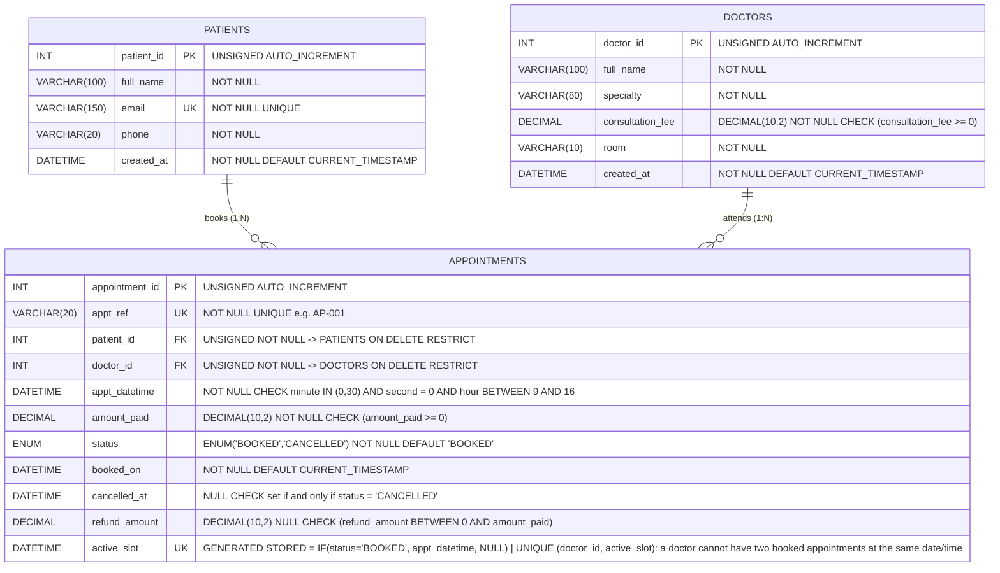

# MediBook — Clinic Appointment API

Backend service for booking doctor appointments at a community clinic.
Doctors see patients in 30-minute slots between 09:00 and 17:00, with a maximum of 12 appointments per doctor per day.

**Stack:** Node.js · Express · MySQL (`mysql2`, parameterized queries, no ORM) · Redis · Jest

> The assignment brief is in [`README.md`](README.md). This file documents the implementation.

---

## Prerequisites

- [Node.js](https://nodejs.org/) 18+ (developed on Node 22)
- [Docker Desktop](https://www.docker.com/products/docker-desktop/) (runs MySQL and Redis)

## Setup

```bash
# 1. Clone and enter the project
git clone https://github.com/AimeCyuzuzo/adv-backend-summative-medibook-project
cd adv-backend-summative-medibook-project

# 2. Create your environment file and set a DB password
cp .env.example .env

# 3. Start MySQL and Redis
docker compose up -d
docker compose ps          # wait until mysql shows "healthy"

# 4. Install dependencies and start the API
npm install
npm start
```

On its **first** start, the MySQL container automatically runs `database/schema.sql` and then `database/seed.sql`.

After that, manage the database **inside the running container** with the `db:*` scripts (no need to take Docker down):

```bash
npm run db:reset    # drop + recreate the database, then run schema.sql and seed.sql
```

See [Scripts](#scripts) for the individual commands.

## Environment variables

Defined in `.env` (not committed). See [`.env.example`](.env.example).

| Variable | Default | Description |
|---|---|---|
| `PORT` | `3000` | Port the Express API listens on |
| `DB_HOST` | `127.0.0.1` | MySQL host |
| `DB_PORT` | `3307` | MySQL port (mapped from the container's 3306 to avoid clashing with a local MySQL) |
| `DB_USER` | `root` | MySQL user |
| `DB_PASSWORD` | — | MySQL password (also used by Docker to initialise the container) |
| `DB_NAME` | `medibook` | Database name |
| `REDIS_URL` | `redis://127.0.0.1:6379` | Redis connection URL |

## Services (Docker)

| Service | Image | Host port | Purpose |
|---|---|---|---|
| `mysql` | `mysql:8.4` | `3307` | Application database |
| `redis` | `redis:7-alpine` | `6379` | Waitlist and notification queues |

Useful commands:

```bash
npm run db:shell                              # MySQL shell (no password prompt)
docker exec -it medibook-redis redis-cli      # Redis shell
docker compose logs -f mysql                  # follow MySQL logs
docker compose down                           # stop (keeps data)
docker compose down -v                        # stop AND delete all data (full wipe)
```

## Project structure

```
├── database/          schema.sql and seed.sql
├── src/
│   ├── app.js         Express app (middleware, routes, error handler)
│   ├── config/db.js   mysql2 connection pool
│   ├── models/        all SQL lives here (parameterized queries only)
│   ├── controllers/   business logic; calls models, never the DB directly
│   ├── routes/        maps URLs + HTTP methods to controllers
│   ├── validators/    pure validation functions (unit-tested)
│   ├── middleware/    404 + central error handler
│   └── utils/         AppError
├── scripts/db.sh      database management (used by the db:* npm scripts)
├── server.js          entry point: checks DB connection, then starts listening
├── docker-compose.yml MySQL + Redis for local development
└── .env.example       template for environment variables
```

## Scripts

| Command | Description |
|---|---|
| `npm start` | Start the API |
| `npm run dev` | Start the API with auto-reload (nodemon) |
| `npm test` | Run Jest unit tests |
| `npm run db:schema` | Run `database/schema.sql` |
| `npm run db:seed` | Run `database/seed.sql` |
| `npm run db:reset` | Drop and recreate the database, then run schema + seed |
| `npm run db:drop` | Drop and recreate an empty database |
| `npm run db:shell` | Open a MySQL shell in the container |

The `db:*` scripts require the containers to be running (`docker compose up -d`). They execute inside the
`mysql` container using its own `MYSQL_ROOT_PASSWORD`, reading the SQL files from the mounted `database/` folder.

> Running `db:seed` twice without a reset fails with duplicate-key errors — use `db:reset` for a clean slate.

---

## Database design (Part A)

Source: [`schema-diagram.mmd`](schema-diagram.mmd) (Mermaid) — exported as `schema-diagram.png`.



### Normalization

_TODO (in your own words): repeated patient/doctor data in the spreadsheet → transitive dependencies
`appt_ref → patient_email → name, phone` and `appt_ref → doctor → specialty, fee, room` → split into 3 tables.
Note why `amount_paid` stays on `appointments` (AP-002 paid 120 vs a 150 fee)._

### Key constraints

| Business rule | Enforced by |
|---|---|
| A doctor cannot have two appointments at the same date/time | `UNIQUE (doctor_id, active_slot)` — `active_slot` is NULL for cancelled rows, and `UNIQUE` allows multiple NULLs, so a cancelled slot can be rebooked while the cancelled row is kept for refund history |
| Slots are on 30-minute boundaries within 09:00–17:00 | `CHECK` on `appt_datetime` (last slot starts 16:30) |
| Money is never negative; refund never exceeds amount paid | `CHECK` on `consultation_fee`, `amount_paid`, `refund_amount` |
| Cancellation data is consistent | `CHECK` tying `cancelled_at` to `status` |
| Refund history is never lost | `ON DELETE RESTRICT` on both foreign keys |
| Bookings must be in the future / max 12 per doctor per day | **Application level** (Part C) — MySQL `CHECK` cannot use `NOW()` or count other rows |

## API endpoints (Part C)

All responses are JSON. Success: `{ "data": ... }`. Errors: `{ "error": { "message": "...", "details": [...] } }`.

### Patients

| Method | Path | Description | Success | Errors |
|---|---|---|---|---|
| `GET` | `/api/patients` | List all patients | `200` | — |
| `GET` | `/api/patients/:id` | Get one patient | `200` | `400` bad id, `404` |
| `POST` | `/api/patients` | Create a patient (`full_name`, `email`, `phone`) | `201` + `Location` | `400` validation, `409` email taken |
| `PATCH` | `/api/patients/:id` | Update any subset of fields | `200` | `400`, `404`, `409` email taken |
| `DELETE` | `/api/patients/:id` | Delete a patient | `204` | `404`, `409` has appointments |

`PATCH` (not `PUT`) is used because clients may send only the fields they want to change.
Patients with appointments cannot be deleted (`ON DELETE RESTRICT`) so refund history is never lost.

### Doctors

_TODO_

### Error handling

A central middleware (`src/middleware/errorHandler.js`) converts errors into responses:
`AppError` → its status code; malformed JSON → `400`; MySQL `ER_DUP_ENTRY` → `409`,
`ER_CHECK_CONSTRAINT_VIOLATED` → `422`, `ER_ROW_IS_REFERENCED_2` → `409`; anything else → `500` without leaking internals.

## Design justifications

### Part C — Booking & cancellation

_TODO: how concurrent double-booking is prevented, how the 12/day cap is enforced, refund boundary policy, transaction for cancellation + refund._

### Part D — Audit logging

_TODO_

### Part E — Waitlist & notifications

_TODO: queue design, worker process, what happens if a promoted booking fails._

## Testing (Part F)

_TODO_

## Feedback page (Part G)

_TODO_
