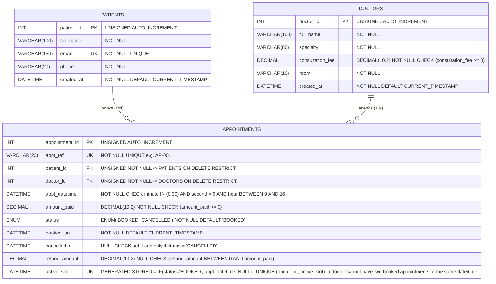

# MediBook — Clinic Appointment API

Backend service for booking doctor appointments at a community clinic.
Doctors see patients in 30-minute slots between 09:00 and 17:00, with a maximum of 12 appointments per doctor per day.

**Stack:** Node.js · Express · MySQL (`mysql2`, parameterized queries, no ORM) · Redis · Jest

> The assignment brief is in [`README.md`](README.md). This file documents the implementation.

---

## Prerequisites

- [Node.js](https://nodejs.org/) 18+ (developed on Node 22)
- [Docker Desktop](https://www.docker.com/products/docker-desktop/) (runs MySQL and Redis)

## Setup

```bash
# 1. Clone and enter the project
git clone https://github.com/AimeCyuzuzo/adv-backend-summative-medibook-project
cd adv-backend-summative-medibook-project

# 2. Create your environment file and set a DB password
cp .env.example .env

# 3. Start MySQL and Redis
docker compose up -d
docker compose ps          # wait until mysql shows "healthy"

# 4. Install dependencies and start the API
npm install
npm start
```

On its **first** start, the MySQL container automatically runs `database/schema.sql` and then `database/seed.sql`.

Upcoming seed appointments are dated **relative to today** (`CURDATE() + INTERVAL n DAY`), so the stats and
busy-days report always have data to show. Run `npm run db:reset` before a demo to refresh them.

After that, manage the database **inside the running container** with the `db:*` scripts (no need to take Docker down):

```bash
npm run db:reset    # drop + recreate the database, then run schema.sql and seed.sql
```

See [Scripts](#scripts) for the individual commands.

## Environment variables

Defined in `.env` (not committed). See [`.env.example`](.env.example).

| Variable | Default | Description |
|---|---|---|
| `PORT` | `3000` | Port the Express API listens on |
| `DB_HOST` | `127.0.0.1` | MySQL host |
| `DB_PORT` | `3307` | MySQL port (mapped from the container's 3306 to avoid clashing with a local MySQL) |
| `DB_USER` | `root` | MySQL user |
| `DB_PASSWORD` | — | MySQL password (also used by Docker to initialise the container) |
| `DB_NAME` | `medibook` | Database name |
| `REDIS_URL` | `redis://127.0.0.1:6379` | Redis connection URL |
| `CLINIC_TZ` | `Africa/Kigali` | Clinic timezone (IANA name) used for all business rules |

### Timezone

`appt_datetime` is stored as **clinic local time** (a `DATETIME` has no timezone), because the business rules
are defined in local time: working hours 09:00–17:00, the 12-per-**day** cap, and per-day reports.
Converting only at display time would be too late — the rules would already have run on the wrong clock.

- **Node owns "now"** (`src/utils/clock.js`): the current clinic time is computed with `Intl.DateTimeFormat`
  in `CLINIC_TZ` and passed into SQL as a `?` parameter. This also keeps the slot and refund functions pure
  and unit-testable (tests pass a fixed `now`).
- The MySQL container also runs in `CLINIC_TZ` (`TZ` in `docker-compose.yml`), so `CURRENT_TIMESTAMP` defaults
  like `created_at` match the app's clock.

## Services (Docker)

| Service | Image | Host port | Purpose |
|---|---|---|---|
| `mysql` | `mysql:8.4` | `3307` | Application database |
| `redis` | `redis:7-alpine` | `6379` | Waitlist and notification queues |

Useful commands:

```bash
npm run db:shell                              # MySQL shell (no password prompt)
docker exec -it medibook-redis redis-cli      # Redis shell
docker compose logs -f mysql                  # follow MySQL logs
docker compose down                           # stop (keeps data)
docker compose down -v                        # stop AND delete all data (full wipe)
```

## Project structure

```
├── database/          schema.sql and seed.sql
├── src/
│   ├── app.js         Express app (middleware, routes, error handler)
│   ├── config/db.js   mysql2 connection pool
│   ├── models/        all SQL lives here (parameterized queries only)
│   ├── controllers/   business logic; calls models, never the DB directly
│   ├── routes/        maps URLs + HTTP methods to controllers
│   ├── validators/    pure validation functions (unit-tested)
│   ├── middleware/    404 + central error handler
│   └── utils/         AppError
├── scripts/db.sh      database management (used by the db:* npm scripts)
├── server.js          entry point: checks DB connection, then starts listening
├── docker-compose.yml MySQL + Redis for local development
└── .env.example       template for environment variables
```

## Scripts

| Command | Description |
|---|---|
| `npm start` | Start the API |
| `npm run dev` | Start the API with auto-reload (nodemon) |
| `npm test` | Run Jest unit tests |
| `npm run db:schema` | Run `database/schema.sql` |
| `npm run db:seed` | Run `database/seed.sql` |
| `npm run db:reset` | Drop and recreate the database, then run schema + seed |
| `npm run db:drop` | Drop and recreate an empty database |
| `npm run db:shell` | Open a MySQL shell in the container |

The `db:*` scripts require the containers to be running (`docker compose up -d`). They execute inside the
`mysql` container using its own `MYSQL_ROOT_PASSWORD`, reading the SQL files from the mounted `database/` folder.

> Running `db:seed` twice without a reset fails with duplicate-key errors — use `db:reset` for a clean slate.

---

## Database design (Part A)

Source: [`schema-diagram.mmd`](schema-diagram.mmd) (Mermaid) — exported as `schema-diagram.png`.



### Normalization

_TODO (in your own words): repeated patient/doctor data in the spreadsheet → transitive dependencies
`appt_ref → patient_email → name, phone` and `appt_ref → doctor → specialty, fee, room` → split into 3 tables.
Note why `amount_paid` stays on `appointments` (AP-002 paid 120 vs a 150 fee)._

### Key constraints

| Business rule | Enforced by |
|---|---|
| A doctor cannot have two appointments at the same date/time | `UNIQUE (doctor_id, active_slot)` — `active_slot` is NULL for cancelled rows, and `UNIQUE` allows multiple NULLs, so a cancelled slot can be rebooked while the cancelled row is kept for refund history |
| Slots are on 30-minute boundaries within 09:00–17:00 | `CHECK` on `appt_datetime` (last slot starts 16:30) |
| Money is never negative; refund never exceeds amount paid | `CHECK` on `consultation_fee`, `amount_paid`, `refund_amount` |
| Cancellation data is consistent | `CHECK` tying `cancelled_at` to `status` |
| Refund history is never lost | `ON DELETE RESTRICT` on both foreign keys |
| Bookings must be in the future / max 12 per doctor per day | **Application level** (Part C) — MySQL `CHECK` cannot use `NOW()` or count other rows |

## API endpoints (Part C)

All responses are JSON. Success: `{ "data": ... }`. Errors: `{ "error": { "message": "...", "details": [...] } }`.

### Patients

| Method | Path | Description | Success | Errors |
|---|---|---|---|---|
| `GET` | `/api/patients` | List all patients | `200` | — |
| `GET` | `/api/patients/:id` | Get one patient | `200` | `400` bad id, `404` |
| `POST` | `/api/patients` | Create a patient (`full_name`, `email`, `phone`) | `201` + `Location` | `400` validation, `409` email taken |
| `PATCH` | `/api/patients/:id` | Update any subset of fields | `200` | `400`, `404`, `409` email taken |
| `DELETE` | `/api/patients/:id` | Delete a patient | `204` | `404`, `409` has appointments |

`PATCH` (not `PUT`) is used because clients may send only the fields they want to change.
Patients with appointments cannot be deleted (`ON DELETE RESTRICT`) so refund history is never lost.

### Doctors

| Method | Path | Description | Success | Errors |
|---|---|---|---|---|
| `GET` | `/api/doctors` | List all doctors | `200` | — |
| `GET` | `/api/doctors/:id` | Get one doctor | `200` | `400` bad id, `404` |
| `POST` | `/api/doctors` | Create a doctor (`full_name`, `specialty`, `consultation_fee`, `room`) | `201` + `Location` | `400` validation |
| `PATCH` | `/api/doctors/:id` | Update any subset of fields | `200` | `400`, `404` |
| `DELETE` | `/api/doctors/:id` | Delete a doctor | `204` | `404`, `409` has appointments |

`consultation_fee` must be a JSON number ≥ 0 with at most 2 decimal places (fits `DECIMAL(10,2)`).

| Method | Path | Description | Success | Errors |
|---|---|---|---|---|
| `GET` | `/api/doctors/:id/stats` | Revenue collected, upcoming count, appointments per day for the next 7 days, utilization % vs the 12-slot cap | `200` | `400`, `404` |

### Reports

| Method | Path | Description |
|---|---|---|
| `GET` | `/api/reports/doctors` | Every doctor's total / booked / cancelled appointments, amount paid, refunded and revenue — **including doctors with zero appointments** |
| `GET` | `/api/reports/busy-days` | Every (doctor, date) with **more than 80%** of the 12-slot cap booked (i.e. ≥ 10 appointments) |

**Definitions** (all computed in SQL in `src/models/Doctor.js` and `src/models/Report.js`):

- **Revenue collected** = `SUM(amount_paid − refund_amount)`. Patients pay at booking, so upcoming bookings count; refunds are subtracted.
- **Upcoming** = `BOOKED` appointments after the current clinic time.
- **Next 7 days** = today plus the following 6 days. A recursive CTE generates the 7 dates and appointments are
  `LEFT JOIN`ed onto them, so days with no appointments still appear with `0`.
- **Utilization %** = booked ÷ 12 × 100 per day, and booked ÷ (7 × 12) × 100 for the whole week.
- **Doctors report** uses `LEFT JOIN doctors → appointments`, so doctors with no appointments appear with zeros
  (`COUNT(a.appointment_id)` ignores the NULL row; `COALESCE` turns NULL sums into `0`).
- **Busy days** filters rows with `WHERE status = 'BOOKED'` *before* grouping, then filters groups with
  `HAVING COUNT(*) > 12 × 80 / 100` *after* grouping. Cancelled appointments don't count.

### Appointments

| Method | Path | Description | Success | Errors |
|---|---|---|---|---|
| `POST` | `/api/appointments` | Book (`patient_id`, `doctor_id`, `appt_datetime` e.g. `"2026-12-01 09:30"`) | `201` + `Location` | `400` malformed, `404` patient/doctor, `409` slot taken / day full, `422` past / outside hours / not on a 30-min boundary |
| `GET` | `/api/appointments/:id` | Get one appointment (incl. cancelled) | `200` | `400`, `404` |
| `DELETE` | `/api/appointments/:id` | Cancel; response includes the refund | `200` | `400`, `404`, `409` already cancelled / already taken place |

`amount_paid` is set by the server from the doctor's `consultation_fee` — clients can't choose what they pay.
`DELETE` cancels rather than erases: the row is kept with `status = CANCELLED` for refund history, so it returns
`200` with the refund (not `204`). The `409` booking responses include `details.reason` (`SLOT_TAKEN` / `DAY_FULL`)
and `waitlist_available: true` (see Part E).

### Error handling

A central middleware (`src/middleware/errorHandler.js`) converts errors into responses:
`AppError` → its status code; malformed JSON → `400`; MySQL `ER_DUP_ENTRY` → `409`,
`ER_CHECK_CONSTRAINT_VIOLATED` → `422`, `ER_ROW_IS_REFERENCED_2` → `409`; anything else → `500` without leaking internals.

## Design justifications

### Part C — Booking & cancellation

Pure rules live in `src/utils/booking-rules.js` (`validateSlot`, `calculateRefund`). They take `now` as an
argument, so they have no DB or clock dependency and are unit-tested directly.

**Future / working hours / 30-minute slots.** `validateSlot()` rejects malformed dates (`400`) and past,
out-of-hours or misaligned times (`422`) before any DB work. Working hours are 09:00–17:00, so the last slot
*starts* at 16:30; 17:00 is rejected. `chk_appt_slot` in the schema repeats the hours/boundary rule as a safety net.

**Max 12 per doctor per day.** A `CHECK` can't count rows, so this is enforced in a transaction
(`src/config/transaction.js`): the doctor's row is locked with `SELECT … FOR UPDATE`, then the day's `BOOKED`
appointments are counted, then the new one is inserted, then commit. Concurrent bookings for the *same* doctor
queue on that lock, so two requests can't both read "11" and both insert. Bookings for other doctors aren't blocked.
*Tested:* with 11 booked, 4 simultaneous requests for different slots → exactly one `201`, three `409 DAY_FULL`.

**Two patients can never hold the same slot.** `UNIQUE (doctor_id, active_slot)` in the database is the
guarantee — it holds even if application code is bypassed. The losing `INSERT` fails with `ER_DUP_ENTRY`,
returned as `409 SLOT_TAKEN`. *Tested:* 6 simultaneous requests for one slot → exactly one `201`.

**Refund policy** (computed by the server from the notice given):

| Notice before appointment | Refund |
|---|---|
| more than 48 h | 100% |
| 24 h to 48 h (**both boundaries inclusive**: exactly 48 h → 50%, exactly 24 h → 50%) | 50% |
| less than 24 h | 0% |

Amounts are calculated in cents to avoid floating-point errors. Appointments that have already started can't be cancelled (`409`).

**Cancellation and refund succeed or fail together.** Both are written by one `UPDATE` (status, `cancelled_at`,
`refund_amount`) inside a transaction that first locks the row (`FOR UPDATE`), so two concurrent cancellations
can't both refund it. `chk_appt_cancellation` also rejects a cancelled row without a refund.

**Cancelled slots become bookable again.** `active_slot` is a generated column, NULL when cancelled. `UNIQUE`
ignores NULLs, so the slot frees up while the cancelled row is kept for refund history.

### Part D — Audit logging

Every successful booking and cancellation is appended to `logs/audit.log` as one JSON object per line
(JSON Lines) by `audit()` in `src/utils/auditLogger.js`. Example:

```json
{"timestamp":"2026-11-23T20:59:39.116Z","event":"APPOINTMENT_CANCELLED","appointment_id":18,"appt_ref":"AP-A1FC8A9F","patient_id":1,"doctor_id":3,"appt_datetime":"2026-11-29 10:00:00","cancelled_at":"2026-11-23 22:59:39","hours_notice":131.01,"refund_percent":100,"refund_amount":80}
```

- **Async, non-blocking.** Uses `fs/promises` (`mkdir`, `appendFile`). There are no `*Sync` calls anywhere in
  `src/`, so the event loop keeps serving other requests during the write.
- **Creates `logs/` on first run.** `mkdir(..., { recursive: true })` runs before each append. It's a no-op when
  the folder exists, and it also recovers if the folder is deleted while the server is running.
- **A logging failure never fails the request.** `audit()` catches its own errors, reports them to stderr and resolves
  `false`; it never rejects. Controllers call it *without* `await` (fire-and-forget), *after* the transaction
  has committed, so the response doesn't wait on the disk.
  *Tested:* with the log path pointed at an unwritable location, bookings still returned `201` and the failure was printed to stderr.
- **Only successful operations are logged.** The call comes after the commit, so rejected or rolled-back requests
  (`409`, `422`, …) never appear in the log.
- **Timestamps are ISO-8601 UTC** (unambiguous for logs); appointment times are clinic local, as stored.
- Appending one short line per call keeps entries intact when requests run at the same time. `logs/` is git-ignored.
  `AUDIT_LOG_PATH` can override the location (used for testing).

### Part E — Waitlist & notifications

_TODO: queue design, worker process, what happens if a promoted booking fails._

## Testing (Part F)

_TODO_

## Feedback page (Part G)

_TODO_
